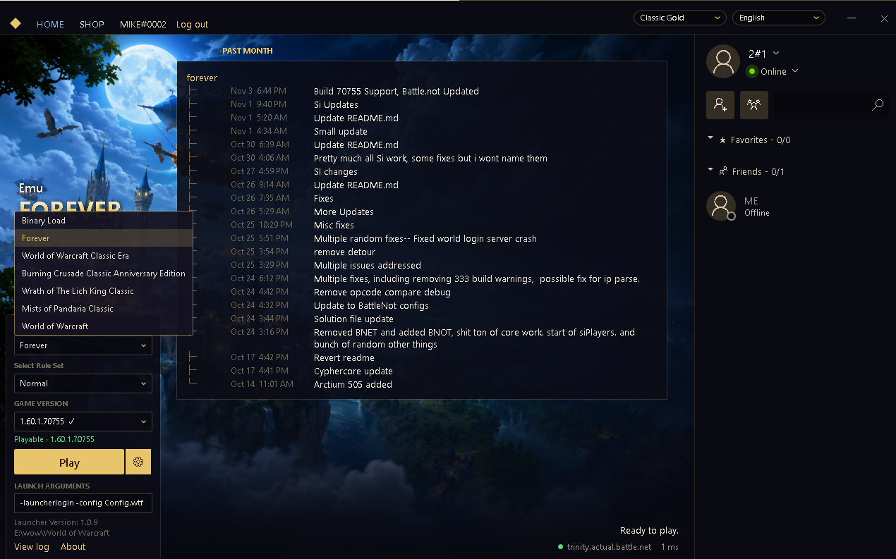
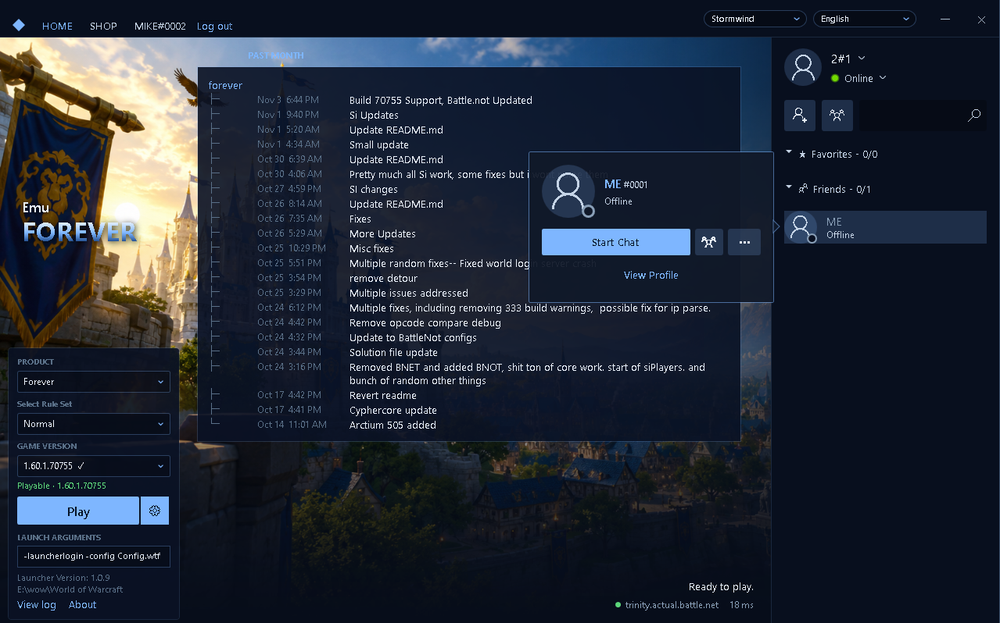
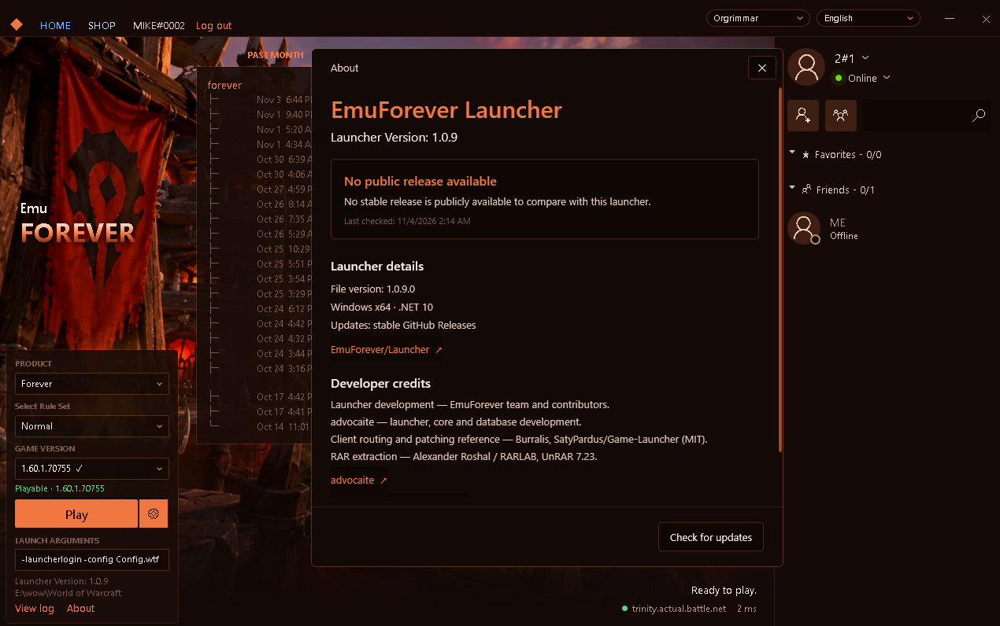
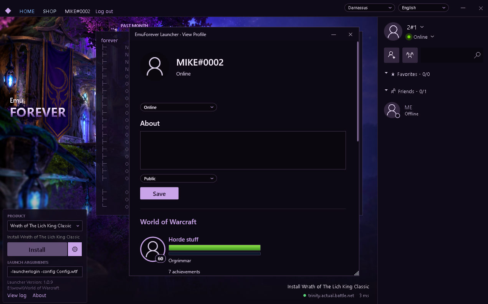
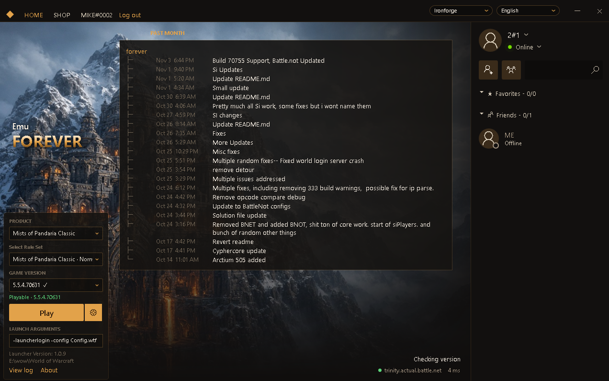
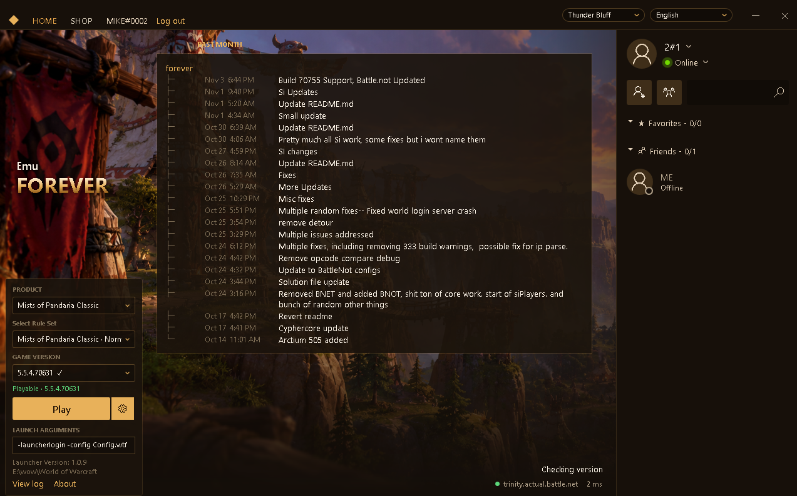
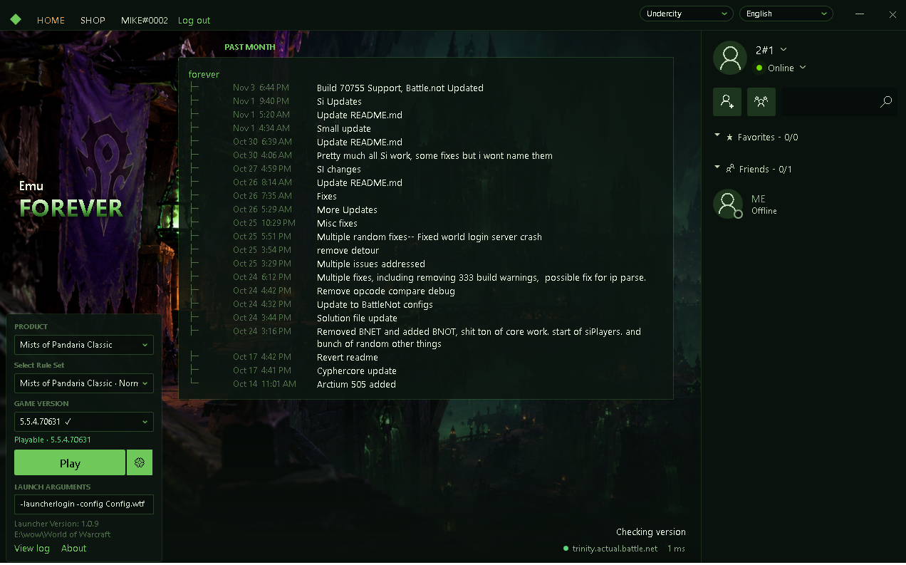
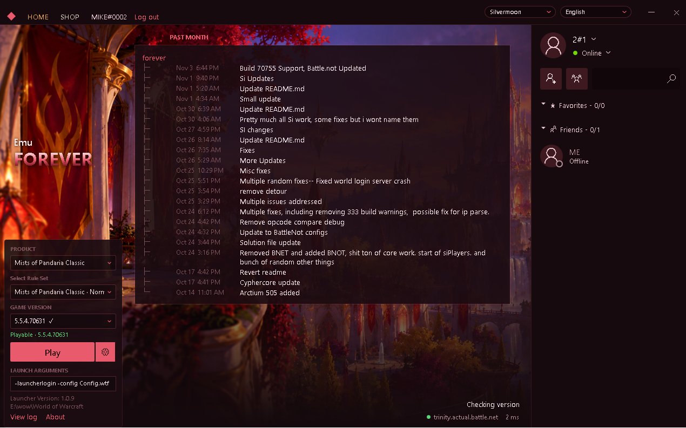
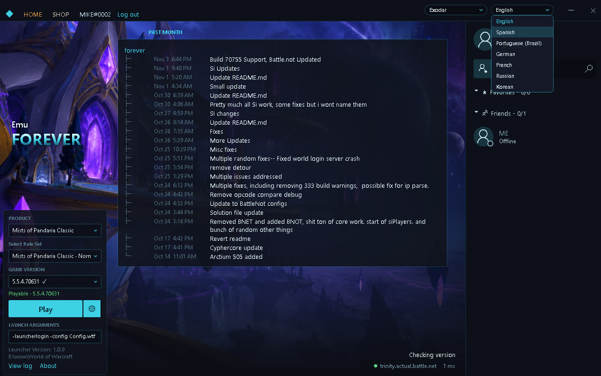
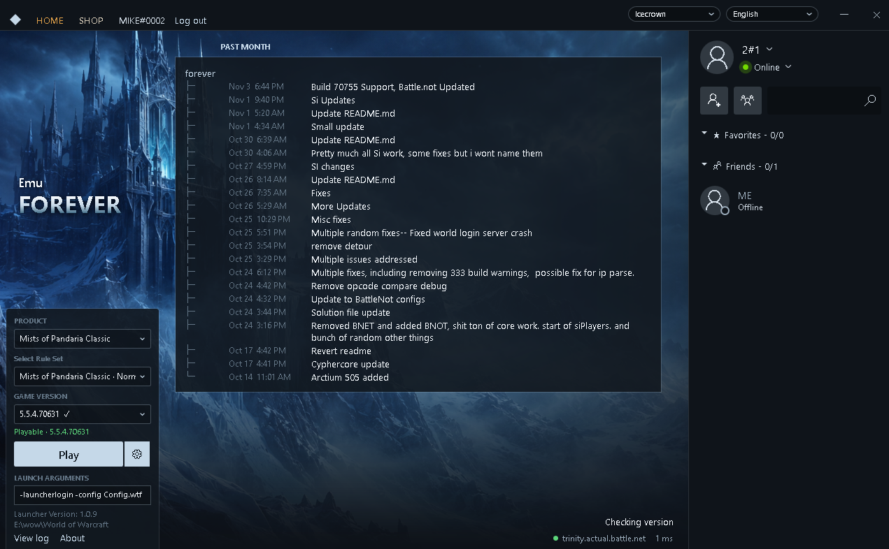

# EmuForever Launcher

A portable Windows x64 launcher for EmuForever and compatible BattleNot servers.
Launch and patch supported World of Warcraft clients from one place.

- Server-provided products, realms and client-version checks.
- Game accounts, friends, chat windows and character profiles.
- Custom launch arguments and manual executable mode.
- Automatic launcher updates, ten themes and multiple languages.

## Download

Download **EmuForeverLauncher.rar** from [Latest Release](https://github.com/EmuForever/Launcher/releases/latest),
extract it and run **EmuForeverLauncher.exe**. The .NET runtime is included.

## Supported clients

| Client | Verified version / build |
| --- | --- |
| WoW Forever | 1.60.1 / 70790 |
| Burning Crusade Anniversary | 2.5.6 / 70577 |
| Mists of Pandaria Classic | 5.5.4 / 70631 |
| Classic Era | 1.15.9 / 70576 |
| Retail | 12.1.5 / 70688 |

Available products and realms depend on the selected BattleNot server.

## Supported languages

English, Spanish, Portuguese (Brazil), German, French, Russian and Korean.

## Credits

- **EmuForever team and contributors** — launcher development.
- **[advocaite](https://github.com/advocaite)** — launcher, core and database development.
- **[Burralis / SatyPardus](https://github.com/SatyPardus/Game-Launcher)** — client routing and patching reference.

## Themes

Previews use sample account and news content.

| | |
| --- | --- |
| **Classic Gold**  | **Stormwind**  |
| **Orgrimmar**  | **Darnassus**  |
| **Ironforge**  | **Thunder Bluff**  |
| **Undercity**  | **Silvermoon**  |
| **Exodar**  | **Icecrown**  |
